# Learner

<p align="center">
  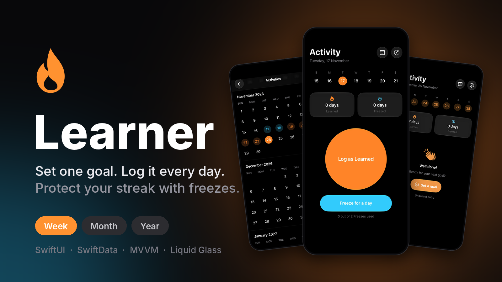
</p>

<p align="center">
  <b>A daily learning tracker for iPhone.</b><br>
  Set one goal, log your learning every day, protect your streak with limited freezes, and see your whole history in a calendar.
</p>

<p align="center">
  
  
  
  
  
</p>

---

## Contents

1. [About](#about)
2. [See it in action](#see-it-in-action)
3. [Screens](#screens)
4. [Main features](#main-features)
5. [Beyond the brief](#beyond-the-brief)
6. [How I built the Sketch design in SwiftUI](#how-i-built-the-sketch-design-in-swiftui)
7. [Rules at a glance](#rules-at-a-glance)
8. [Notifications](#notifications)
9. [Testing: every scenario without waiting a week](#testing-every-scenario-without-waiting-a-week)
10. [Architecture](#architecture)
11. [Every page and where its logic lives](#every-page-and-where-its-logic-lives)
12. [Data model](#data-model)
13. [Tech stack](#tech-stack)
14. [Getting started](#getting-started)
15. [How it was built](#how-it-was-built)
16. [Roadmap](#roadmap) · [Known limitations](#known-limitations) · [Author](#author)

---

## About

**Learner** helps you build a learning habit. You choose one thing to learn and a time frame (a week, a month, or a year). Every day you log that you learned, or use a limited **freeze** to protect your streak on a day you can't. Finish every day of the goal and you complete it. Miss too much and the goal ends, and you can set a new one.

The app follows a Sketch prototype screen by screen, and then goes further: it reminds you with notifications, lets you start the next goal from a dedicated **Set a goal** page, and ships with a built-in **debug panel** so every situation (even "the week just ended") can be tested in seconds.

## See it in action

<p align="center">
  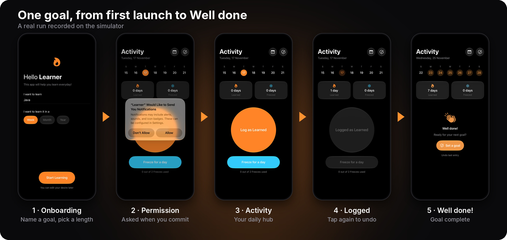
</p>

<!--
  WALKTHROUGH VIDEO
  On GitHub, edit this file and drag your .mp4 into the editor right here.
  GitHub uploads it and inserts a link that plays inline.
-->

## Screens

| Onboarding | Notification permission | Activity |
|:--:|:--:|:--:|
| 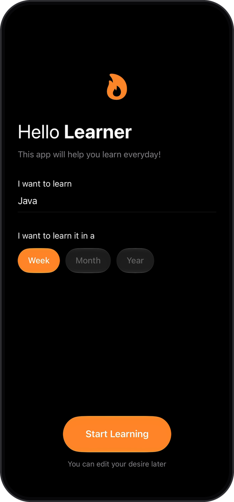 | 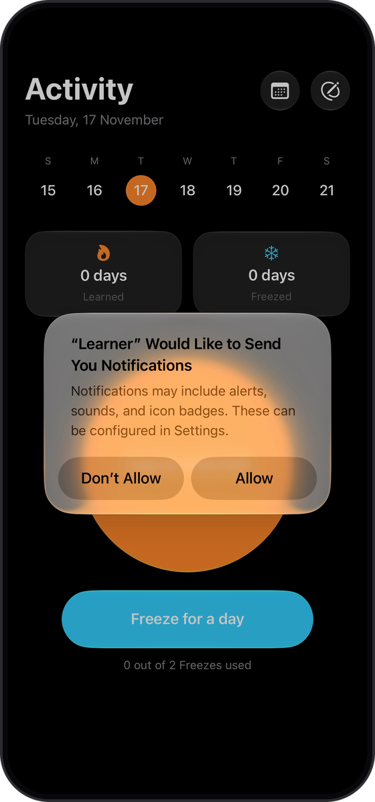 | 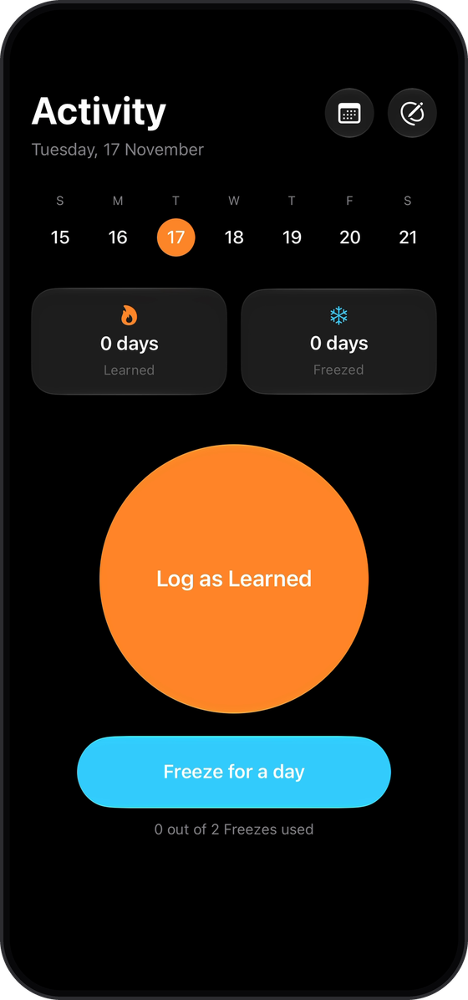 |
| Name a goal, pick Week / Month / Year | Asked once, when you tap Start Learning | The daily hub |

| Logged as Learned | Freezed for a day | Well done! |
|:--:|:--:|:--:|
| 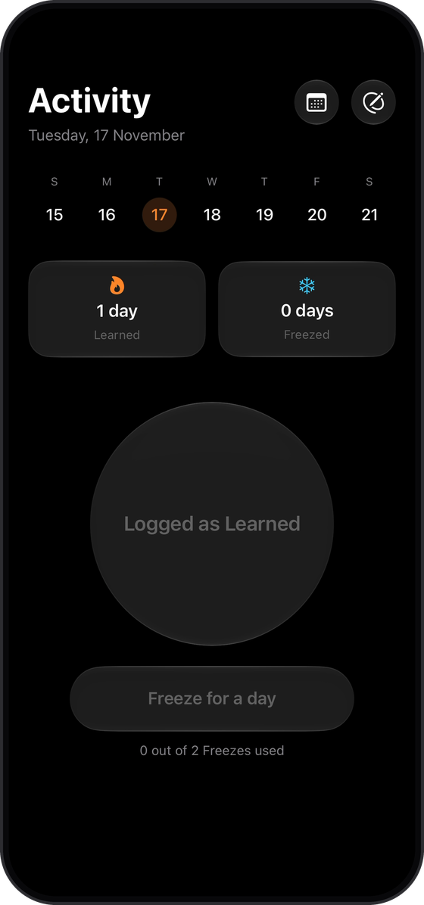 | 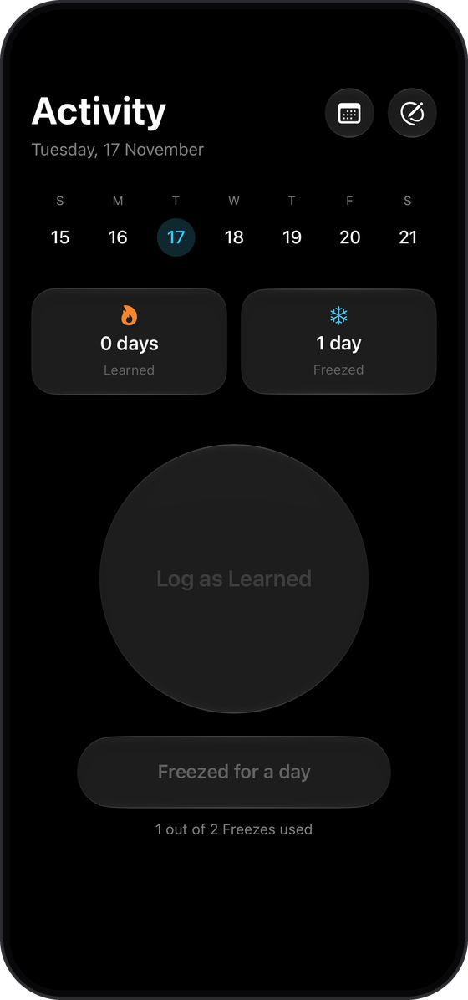 | 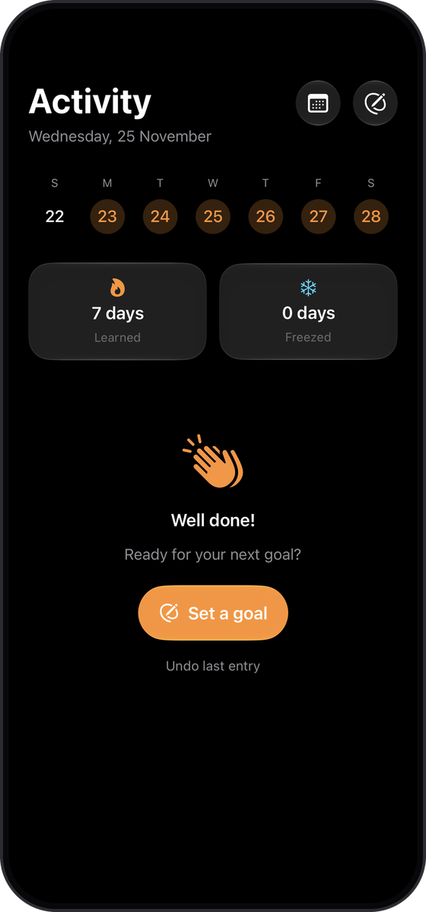 |
| Tap again to undo | Tap again to undo | Every day covered. **Undo last entry** sits under Set a goal |

| Set a goal | Learning Goal | Update goal alert |
|:--:|:--:|:--:|
| 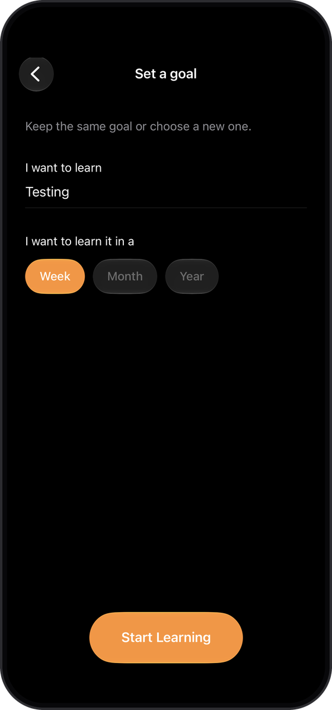 | 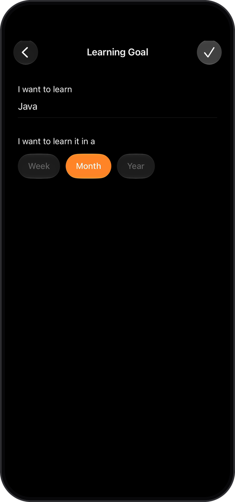 | 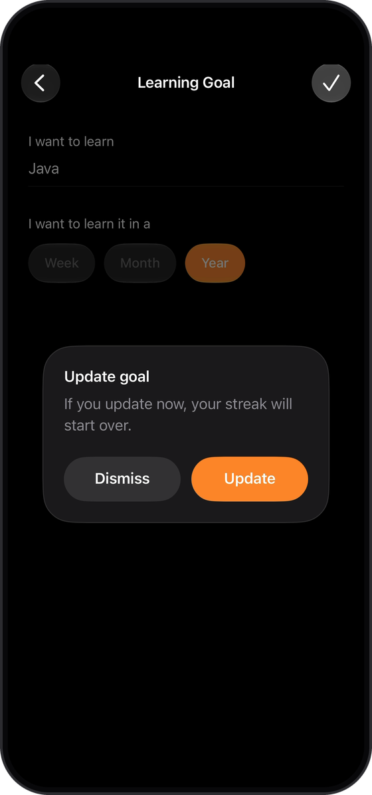 |
| Starts the next goal, pre-filled with the old one | Edits a running goal | Warns that the streak starts over |

| Calendar | Debug panel |
|:--:|:--:|
| 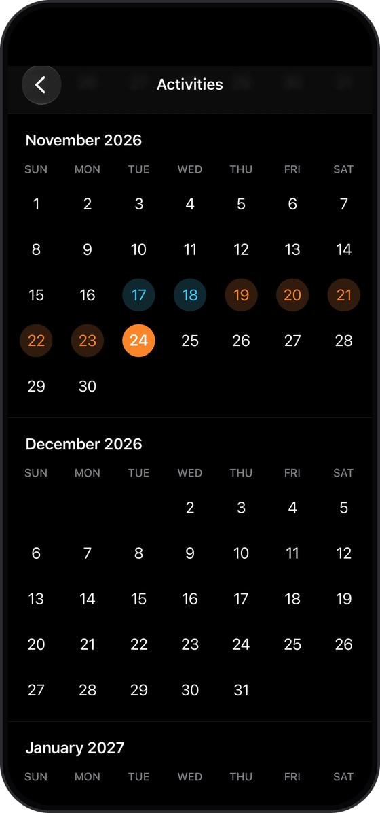 | 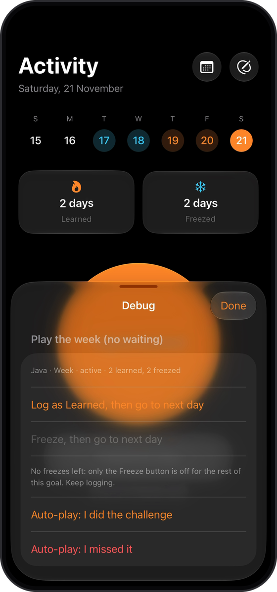 |
| All learned and freezed days, month by month | Debug builds only |

**Goal not met** is the sixth end state: *"You didn't reach your goal this time. Want to set another goal?"* with a **Set a goal** button. Load it any time with the debug scenario **Goal not met**.

## Main features

**Set a goal**
- Choose what you want to learn and for how long: **Week**, **Month**, or **Year**.
- One goal at a time. The goal's length and its number of freezes come from the duration.

<p align="center">
  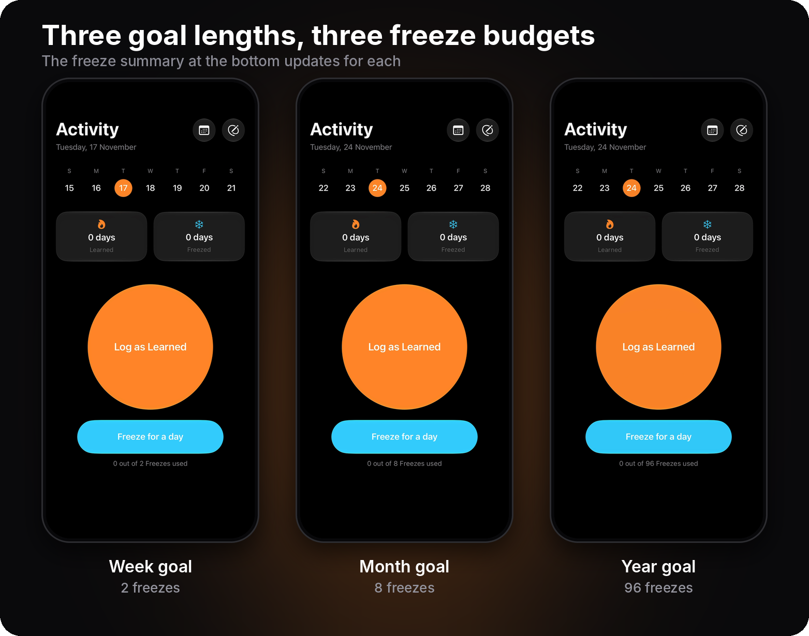
</p>

**Every day**
- **Log as Learned** records today. It counts toward your streak.
- **Freeze for a day** protects today without learning. Freezes are limited: **2 per week goal, 8 per month goal, 96 per year goal**. When they run out, only the Freeze button turns off for the rest of the goal. The goal does not fail.
- **One entry per day.** After you log or freeze, the other button is disabled until midnight.
- **Undo** by tapping the same button again ("Logged as Learned" or "Freezed for a day").
- A **week strip** (S M T W T F S) and two counters (*Learned* and *Freezed*) show where you are.

<p align="center">
  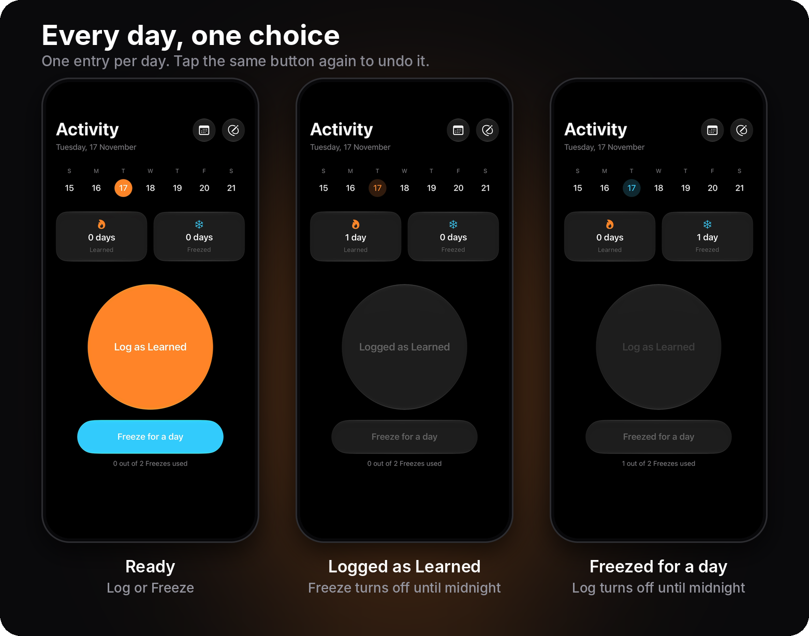
</p>

<p align="center">
  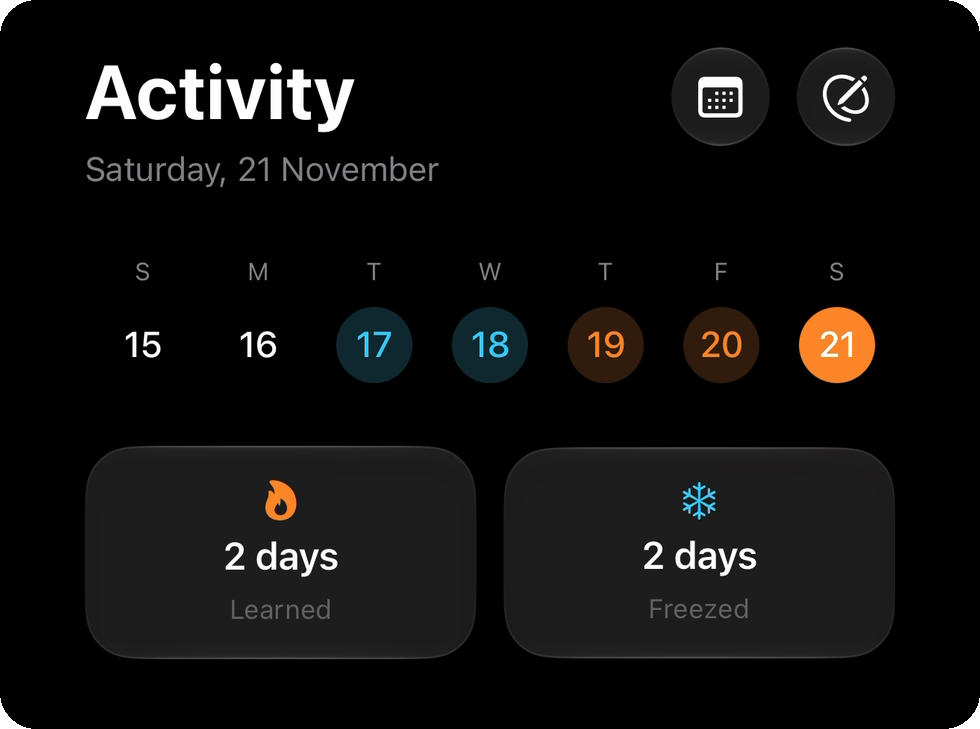
</p>

> **Reading the week strip:** orange tint = a learned day, blue tint = a freezed day, solid orange circle = today.

**When a goal ends**
- **Well done!** when every day of the goal is covered by a learned or freezed day. A small **Undo last entry** link under *Set a goal* reverses a mis-tap (see [Undo on the Well done page](#4-undo-on-the-well-done-page)).
- **You didn't reach your goal this time** when more than 32 hours pass without a learned or freezed day.
- **Set a goal** lets you keep the same goal or choose a new one.
- The **Goal not met** page has no undo link, because a failed goal cannot be reopened.

**Edit a running goal**
- Change the goal or its duration, then tap the **✓** in the toolbar or the **Update goal** button at the bottom. An alert warns that the streak will start over. Your past days stay in the calendar.
- The bottom button hides itself while the keyboard is open, so it never floats over the keyboard. The ✓ stays reachable the whole time.

<p align="center">
  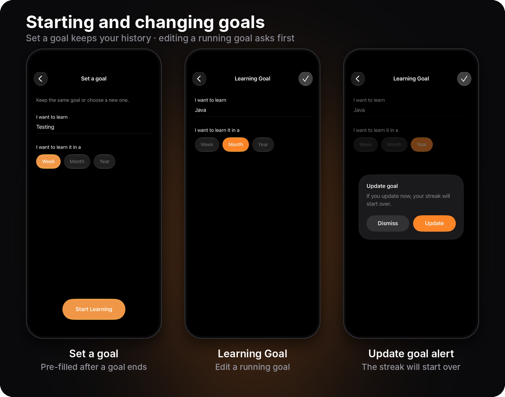
</p>

**Calendar (Activities)**
- A scrolling month-by-month calendar of every learned (orange) and freezed (blue) day across all your goals. View only.

<p align="center">
  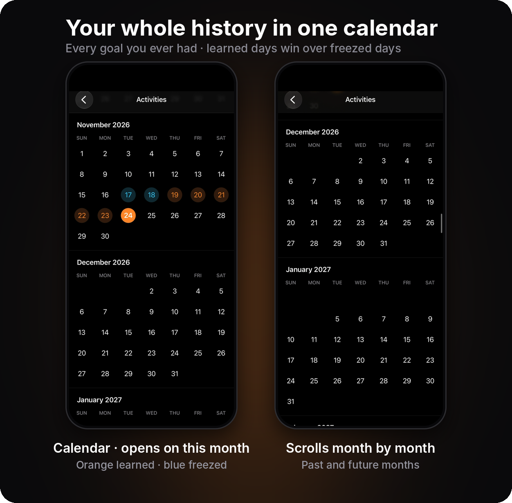
</p>

**Reminders**
- A daily reminder at 8 PM (skipped on days you already logged).
- A warning 3 hours before your streak would end.

**Feels like iOS**
- Dark mode, Liquid Glass buttons and cards, haptics, native navigation with swipe-back, Dynamic Type, and VoiceOver labels.

## Beyond the brief

The Sketch defined the screens. These are the parts I added on top of it.

### 1. A "Set a goal" page

The Sketch has an end screen with a **Set a goal** button, but no page behind it. I built that page (`SetGoalView` + `SetGoalViewModel`).

- It opens from the **Well done!** and **Goal not met** screens (and from the pencil button once a goal has ended).
- It is **pre-filled with the finished goal**, so "do it again" is one tap: Start Learning.
- There is **no "streak will start over" alert**, because a finished goal has no streak left to lose. That alert belongs to the *Learning Goal* page, which edits a goal that is still running.
- The old goal and all its days stay in the calendar. Starting the new goal swaps the Activity page automatically, because `RootView` reacts to the new goal.
- The **Start Learning** button at the bottom hides while you type, the same shared `BottomActionButton` used on Onboarding and Learning Goal.

### 2. Notifications

Local notifications through `UserNotifications`, in `Services/NotificationService.swift`. Permission is asked when the user taps **Start Learning**, not at launch, so the ask comes at the moment the user commits to a goal. Full details are in [Notifications](#notifications).

### 3. A debug and test toolkit

So that every scenario can be checked without restarting the app or waiting for a real week: a hidden debug panel, 12 ready-made scenarios, time travel, "play the week" buttons, previews for every state, and 25 unit tests. Full details are in [Testing](#testing-every-scenario-without-waiting-a-week).

### 4. Undo on the Well done page

If you tap **Log as Learned** on the last day by mistake, Well done appears at once, and a small **Undo last entry** link sits right under **Set a goal**.

<p align="center">
  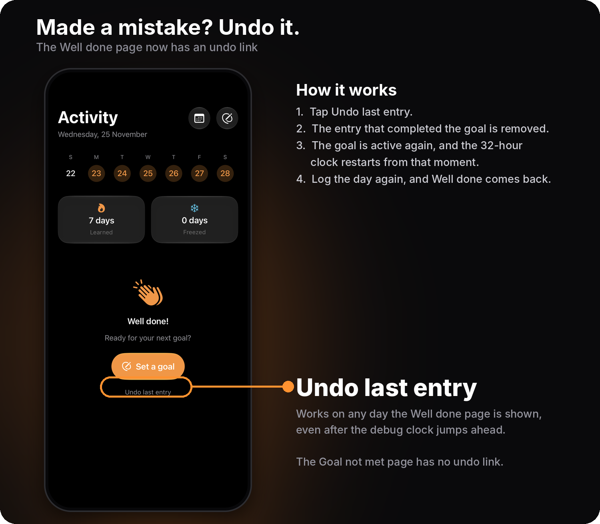
</p>

- It removes the entry that completed the goal and **reopens the goal**, so you can log the day again.
- It works **on any day the Well done page is shown**, not only on the day the goal was completed.
- A late undo does not make the goal fail. The 32-hour clock restarts from the moment you undo (`Goal.resumedAt`).
- It can be pressed again to remove one more day, as long as the goal is still completed.
- The **Goal not met** page never shows it.
- Code: `Goal.canUndoCompletion` and `Goal.undoCompletion` in `GoalLogic.swift`, called by `ActivityViewModel.undoToday`, and drawn by `EndState` in `ActivityView.swift`.

### 5. More polish

| Addition | What it does |
|---|---|
| **Undo** | Tap the same button again to undo today's entry. On the Well done page, **Undo last entry** reverses the entry that completed the goal, on any day. |
| **32-hour streak window** | The streak survives up to 32 hours between entries. An undo is blocked if it would push the goal past that deadline. |
| **Self-updating screen** | While the app stays open, `ActivityViewModel.keepFresh` wakes up at midnight and at the 32-hour deadline, so buttons re-enable and a failed goal shows without a relaunch. |
| **One shared clock** | Every page reads the same `AppClock`, so midnight updates all pages together and tests can fake any day. |
| **Calendar across goals** | The calendar shows the history of every goal you ever had. If two goals touch the same day, learned wins. |
| **Haptics** | Success when you log, light impact on undo, selection tick when changing duration (`sensoryFeedback`). |
| **Accessibility** | VoiceOver labels and hints (for example "Double-tap to undo"), 44 pt tap targets, Dynamic Type. |
| **Adaptive app icon** | An Icon Composer icon (`LJ_Icon.icon`), so iOS can render it for the user's Home Screen style. |
| **Keyboard-aware buttons** | `BottomActionButton` (Start Learning, Update goal) hides while you type and comes back when the keyboard closes, like Apple's own apps. |
| **Double-tap protection** | Navigation allows one push at a time, so a fast double tap can't stack two pages. |

## How I built the Sketch design in SwiftUI

The prototype was a Sketch file. Here is what each part of it became in code.

### Design to code, at a glance

| In the Sketch | In the app | SwiftUI used |
|---|---|---|
| Dark theme, orange `#FF9230` accent, blue `#3CD3FE` for freezes | Brand colors stored in the asset catalog and read through `Color.brandOrange` / `Color.brandFreezeBlue` | Asset-catalog color sets, `.preferredColorScheme(.dark)`, `.tint` |
| "Hello **Learner**" with a regular and a bold word | One `Text` with an interpolated bold `Text` | `Text("Hello \(Text("Learner").fontWeight(.bold))")` |
| Custom Activity header (title, date, two round buttons) | The navigation bar is hidden and the header is drawn by hand | `.toolbar(.hidden, for: .navigationBar)`, `HStack`, `HeaderButton` |
| Round glass buttons, glass cards, glass chips | Real **Liquid Glass**, not images | `.glassEffect(...)`, `GlassEffectContainer`, `.buttonStyle(.glass)` / `.glassProminent` |
| Week strip `S M T W T F S` | The current week, computed from today's date | `Calendar.dateInterval(of: .weekOfYear)`, `ForEach`, `DayBubble` |
| Two counters "2 days Learned / Freezed" | `StatCard` with a numeric transition | `.glassEffect(in: .rect(cornerRadius:))`, `.contentTransition(.numericText())` |
| Big orange **Log as Learned** circle | A glass circle tinted orange, 240 pt wide | `.glassEffect(.regular.tint(...).interactive(), in: .circle)` |
| **Freeze for a day** button, same width as the circle | One shared `controlWidth` so the two always line up | `.buttonStyle(.glassProminent)`, `.frame(width:)` |
| Disabled and "done" looks | Dark glass with gray text | `.glassEffect(.regular)`, `.disabled(...)` |
| End screens (Well done / not met) with no Log or Freeze | A separate `EndState` view replaces the buttons | `switch viewModel.status` inside a `@ViewBuilder` |
| Calendar with weekday labels in every month and a line between months | A lazy list of months, each with its own 7-column grid | `LazyVStack`, `LazyVGrid`, `Divider`, `.scrollPosition(id:)` |
| Orange and blue day circles | One `DayStyle` shared by the week strip and the calendar | `Color.opacity`, `.background(_, in: Circle())` |
| Week / Month / Year chips | `DurationChip`, selected one tinted orange | `.glassEffect(.regular.tint(...).interactive(), in: .capsule)` |
| "Update goal" alert: dark card, gray *Dismiss*, orange *Update* | A custom alert, because the system alert can't style its buttons | `.overlay`, dimmed `Color.black.opacity`, `RoundedRectangle(cornerRadius: 34)`, `.isModal` trait |
| White ✓ in the Learning Goal toolbar | A prominent orange glass button | `ToolbarItem`, `.glassProminent`, disabled until a real change |
| Same goal form on two pages | One shared component | `GoalFormFields` used by Onboarding, Learning Goal and Set a goal |

### The details that make it feel right

<details>
<summary><b>Liquid Glass buttons and cards</b></summary>

Every glass shape is drawn by the system, so it reflects and moves like iOS 26. Neighbouring glass shapes are grouped in a `GlassEffectContainer`, so they blend and animate together.

```swift
GlassEffectContainer(spacing: 12) {
    HStack(spacing: 12) {
        HeaderButton(symbol: "calendar", label: "Calendar") { viewModel.showCalendar() }
        HeaderButton(symbol: "pencil.and.outline", label: "Edit learning goal") { viewModel.showGoalEditor() }
    }
}
```
</details>

<details>
<summary><b>The Log circle has three looks, from one rule</b></summary>

The circle is orange when a **new** log is possible, lightly interactive when only **undo** is possible, and plain dark glass when nothing can be done. The view never decides this itself: it asks the view model, which asks `GoalLogic`.

```swift
let isHighlighted = viewModel.canLog(now: now)       // a NEW log is possible
let isTappable    = viewModel.canTapLog(now: now)    // new log, or undo

Button { viewModel.logLearned(clock: clock, in: modelContext) } label: { ... }
    .glassEffect(
        isHighlighted ? .regular.tint(Color.brandOrange).interactive()
                      : (isTappable ? .regular.interactive() : .regular),
        in: .circle
    )
    .disabled(!isTappable)
```
</details>

<details>
<summary><b>Log circle and Freeze button share one width</b></summary>

In the Sketch the two controls line up. A single constant makes sure they always do:

```swift
private let controlWidth: CGFloat = 240
```
</details>

<details>
<summary><b>The week strip is computed, not hard-coded</b></summary>

```swift
guard let week = calendar.dateInterval(of: .weekOfYear, for: now) else { return [] }
return (0..<7).compactMap { calendar.date(byAdding: .day, value: $0, to: week.start) }
```

Each day becomes a `DayBubble`, which gets its colors from `DayStyle`, the same helper the calendar uses. That is why a day looks identical on both pages.
</details>

<details>
<summary><b>The calendar is lazy and opens on today</b></summary>

`CalendarView` reads every `DayEntry` with `@Query`, builds a month list from one year back (or the first entry) to two years ahead, and scrolls to the current month on appear. Months are drawn lazily, so even a year of history stays smooth.

```swift
ScrollView {
    LazyVStack(alignment: .leading, spacing: 0) { ... }
        .scrollTargetLayout()
}
.scrollPosition(id: $position, anchor: .top)
```
</details>

<details>
<summary><b>A custom "Update goal" alert</b></summary>

The system alert can't style its buttons, so the alert from the Sketch is an overlay: a dim layer that also blocks touches on the page behind it, and a card with a gray **Dismiss** and an orange **Update** button. The ✓ is disabled while the alert is up, and the keyboard closes before it appears.
</details>

<details>
<summary><b>Motion, feedback and keyboard</b></summary>

- `.animation(.smooth, value:)` on state changes, `.snappy` on counters and chips.
- `.sensoryFeedback` for success, impact and selection haptics.
- `.scrollDismissesKeyboard(.interactively)`, `.scrollEdgeEffectStyle(.soft, for: .bottom)`, and `.safeAreaInset(edge: .bottom)` keep the Start Learning button above the keyboard.
- The goal field is limited to 40 characters.
</details>

### Wording kept from the Sketch

"Learned", "**Freezed**", "Freeze for a day", "Freezed for a day", "*x* out of *y* Freezes used", "**Well done!**", "You didn't reach your goal this time.", "Want to set another goal?", "You can edit your desire later".

## Rules at a glance

| Rule | How it works |
|---|---|
| Goal length | Week = 7 days, Month = 30, Year = 365 |
| Freezes per goal | Week = 2, Month = 8, Year = 96 |
| One entry per day | After learned or freezed, the other button is off until midnight |
| Undo | Same button again. Not for a failed goal. Not if it would pass the 32-hour deadline |
| Undo on Well done | **Undo last entry** removes the entry that completed the goal and reopens it, on any day. The 32-hour clock restarts. |
| Goal fails | More than 32 hours without a learned or freezed day |
| Goal completes | Learned days + freezed days reach the goal length |
| No freezes left | Only the Freeze button turns off. The goal keeps running |
| Update a goal | The old goal ends, a new one starts, and the streak restarts. History is kept |


### How a rule flows (undo as the example)

You tap **Logged as Learned** → `ActivityView` calls `viewModel.logLearned` → which calls `goal.logLearned` in `GoalLogic` → `GoalLogic` sees `canUndo` is true and removes today's entry → SwiftData updates → the counters, the week strip and the calendar redraw → the view model re-syncs the notifications.

The counters, the week strip and the calendar all read the same entries, so they can never disagree.

## Notifications

Local notifications, built in `Services/NotificationService.swift`.

| | |
|---|---|
| **When permission is asked** | When the user taps **Start Learning** (on Onboarding and on Set a goal), not at app launch |
| **Daily reminder** | 8:00 PM, scheduled for the next 7 days. *"Time to learn Swift"* / *"Log today to keep your streak going."* |
| **Today's reminder is skipped** | If today is already logged or freezed |
| **Streak warning** | 3 hours before the 32-hour deadline (29 hours after the last entry). *"Your streak is about to end"* / *"Log or freeze today to keep learning Swift."* |
| **Kept in sync** | After every log, freeze, undo, refresh and app wake-up, the service removes all pending notifications and rebuilds them from the goal's current state |
| **Ended goals** | A completed or failed goal schedules nothing |
| **Without permission** | The app works the same, and nothing is scheduled |

Notifications use the real clock, so they are skipped while time-travelling in debug builds and in Xcode previews. The debug panel has two buttons to check them: **Send a test notification in 5 s** and **Show scheduled reminders**.

## Testing: every scenario without waiting a week

You should not have to wait seven real days to see "Well done!", or restart the app to see "Goal not met". Learner has four layers of testing tools.

### 1. The debug panel (debug builds only)

**Open it:** long-press the **Activity title** for 1 second (or the flame on the first screen). The panel stays half-height, so you can keep tapping the real app behind it.

<p align="center">
  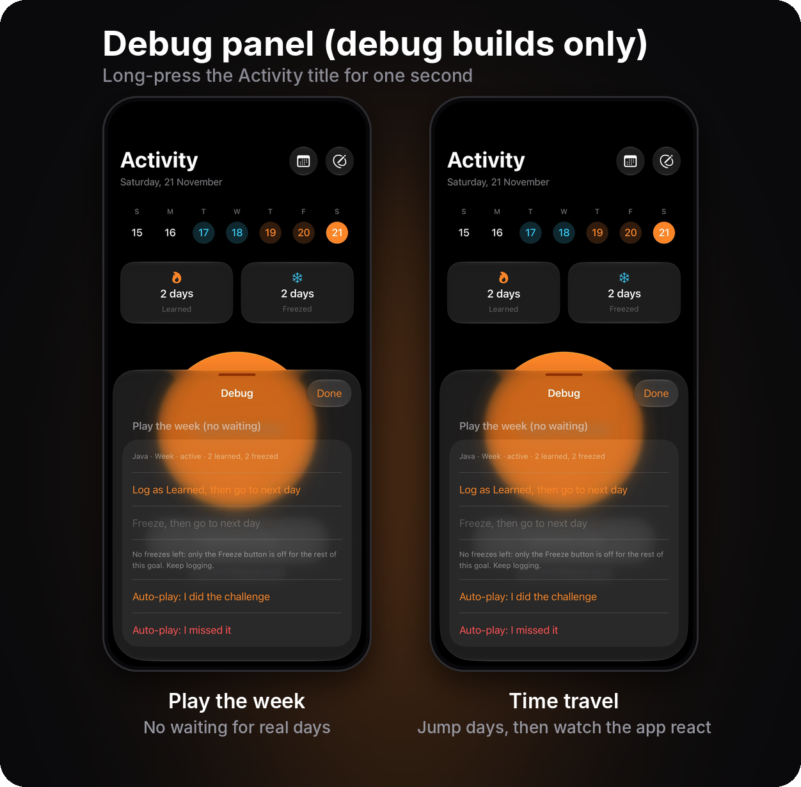
</p>

| Section | What it does |
|---|---|
| **Play the week** | **Log as Learned, then go to next day** and **Freeze, then go to next day** play the week one day at a time (Freeze follows the same rule as the real button). **Auto-play: I did the challenge** plays every remaining day and ends on *Well done!*. **Auto-play: I missed it** skips two days and ends on *not met*. A status line shows the goal, its status, and the counters. |
| **Time travel** | Shows the pretend date and time. **+1 hour**, **+1 day**, **+33 hours** (just past the 32-hour limit), **Reset time**. |
| **Scenarios** | Replaces all data with a ready-made situation (list below). |
| **Notifications** | Send a test notification in 5 s. Show the scheduled reminders. |

**The 12 scenarios**

| Scenario | What you see |
|---|---|
| Fresh install | Empty app: Onboarding |
| Day 1, nothing logged | Week goal just started, both buttons active |
| Mid-week | 3 days of history, today open |
| Logged today | Tap *Logged as Learned* to undo. Freeze is disabled |
| Freezed today | Tap *Freezed for a day* to undo. Log is disabled |
| No freezes left | 2 of 2 freezes used. Freeze disabled, Log active |
| Last day pending | Log today to complete the goal, then try the undo link |
| Goal completed | *Well done!* with Set a goal |
| Goal not met | *You didn't reach your goal* with Set a goal |
| Long history | Two goals and 50 days of history in the calendar |
| Goal completed yesterday | *Well done!* from an earlier day: **Undo last entry** still works |
| Month goal | 8 freezes, 30 days, 2 days logged |

### 2. A two-minute test plan

| I want to check… | Do this |
|---|---|
| The whole week, if I did the challenge | Fresh install → Start Learning → open the panel → **Auto-play: I did the challenge** |
| The whole week, if I did not | Open the panel → **Auto-play: I missed it** |
| A day at a time | Tap **Log as Learned, then go to next day** and watch the week strip and counters |
| One entry per day | Tap *Log as Learned*: Freeze turns off. Tap *Logged as Learned*: it undoes |
| Freezes running out | Scenario **No freezes left** |
| The 32-hour rule | Log once, then **+33 hours** |
| Midnight | **+1 day** after logging: both buttons come back |
| Undo on the last day | Scenario **Last day pending** → Log → **Undo last entry** |
| Undo days later | **Auto-play: I did the challenge** (the clock jumps ahead) → **Undo last entry** → the goal reopens, then log again |
| Set a goal | Scenario **Goal completed** or **Goal not met** → **Set a goal** |
| Editing a running goal | Scenario **Mid-week** → pencil → change a chip → ✓ → alert |
| Every page and button | Walk through Onboarding, Activity, Calendar, Learning Goal and Set a goal |
| Notifications | **Send a test notification in 5 s**, then background the app |

> Scenarios replace all data, and time travel saves entries with the pretend dates. Load **Fresh install** (or delete the app) when you are done.

### 3. Xcode previews for every page and state

Every page has a canvas preview, and `Debug/DebugPanel.swift` adds one per scenario: Fresh install, Day 1, Mid-week, Logged today, Freezed today, No freezes left, Last day pending, Completed, Not met, Completed yesterday and Month goal, plus **Calendar · long history**, **Learning Goal · running goal** and the **Debug panel** itself. Pick them from the preview picker at the bottom-left of the canvas, then turn on **Live** to tap the buttons.

### 4. Unit tests (Swift Testing)

Press **⌘U**. 25 tests cover the rules and the view models:

- **Buttons:** logging locks Freeze, freezing locks Log, one entry per day, buttons return at midnight.
- **Undo:** same button again, only on the same day, freeze given back, reopening a goal undone on its last day, never for a failed goal, and **Undo last entry on the Well done page on any later day**.
- **Freezes:** 2 for a week, 8 for a month, using them all does not fail the goal.
- **Goal end:** the 32-hour rule, seven days complete a week goal, freezed days count toward completion.
- **View models:** Onboarding needs a goal, the editor needs a real change, saving the editor ends the old goal and starts a new one, Set a goal is pre-filled, the calendar lets learned win, month lengths.

Every rule takes the time as an input (`now:`), so the tests use fixed dates and never depend on the real clock.

### Run it as users get it

Product → Scheme → Edit Scheme → Run → Build Configuration → **Release**. The debug panel is wrapped in `#if DEBUG`, so it is not part of the Release app.

## Architecture

The code is split into four layers, so the screens only draw and the rules live in one testable place.

| Layer | Folder | Job |
|---|---|---|
| Data | `Models/` | What exists: goals and daily entries |
| Rules | `Models/GoalLogic.swift` | What is allowed, and when a goal ends |
| Page state | `ViewModels/` | What each page shows and what its buttons do |
| Drawing | `Views/` | Layout, colors, animation |
| iOS services | `Services/` | Notifications |
| Testing | `Debug/`, `LearnerTests/` | Debug panel, scenarios, unit tests |

```
LearnerApp ── database + one shared clock for the whole app
   │
RootView ── no goal ──────────▶ Onboarding ── creates the first Goal
   │
   └─ running goal ───────────▶ Activity ──┬─▶ Calendar
                                           ├─▶ Learning Goal  (edit a running goal)
                                           └─▶ Set a goal     (after the goal ended)
```

Pages never call each other. They change data (a new goal, a new entry) and `RootView` reacts.

### Project structure

```
Learner/
├── App/
│   ├── LearnerApp.swift        # entry point, database, shared clock, dark mode, orange tint
│   ├── AppClock.swift          # one shared "now" for every page (debug time travel lives here)
│   └── RootView.swift          # decides which screen to show
├── Models/
│   ├── Goal.swift              # the saved goal
│   ├── DayEntry.swift          # one logged day (learned or freezed)
│   ├── GoalDuration.swift      # week / month / year and their limits
│   └── GoalLogic.swift         # ALL the rules
├── ViewModels/                 # one per page: Onboarding, Activity, Calendar, GoalEditor, SetGoal
├── Views/                      # one per page, plus Components.swift (goal form, chips, bottom button, day circle)
├── Services/
│   └── NotificationService.swift
├── Resources/
│   └── Theme.swift             # brand colors from the asset catalog
├── Debug/
│   └── DebugPanel.swift        # debug panel, scenarios, previews (debug builds only)
├── LJ_Icon.icon                # adaptive app icon (Icon Composer)
└── Assets.xcassets             # brand colors and accent color
LearnerTests/
└── GoalLogicTest.swift         # unit tests for the rules and view models
```

### Design decisions

- **Counters are derived, never stored.** "4 days learned" is counted from the entries each time, so it can't disagree with the calendar.
- **One shared clock.** Every page asks `AppClock` for "now". Midnight updates all pages together, and tests can fake any day.
- **Rules take the time as an input**, so any scenario can be tested without waiting for real days.
- **Native iOS parts first** (navigation, swipe-back, Liquid Glass, haptics). The update alert is custom, because the system alert can't style its buttons.
- **Entries outlive their goal.** `Goal.entries` uses `deleteRule: .nullify`, so when a goal ends the calendar keeps all its history.

## Every page and where its logic lives

**Layers:** `Models/` hold the data and all rules. `ViewModels/` hold each page's state and decide what the page needs. `Views/` only draw. `Services/` talk to iOS (notifications). `Debug/` exists only for testing.

| Page / file | Job | Rules and logic that live here |
|---|---|---|
| **LearnerApp** | Starts the app: database, shared clock, dark mode, orange tint | Nothing else |
| **AppClock** | One shared "now" that every page reads. Debug time travel lives here | |
| **RootView** | The router. No goal means Onboarding. Otherwise Activity for the running goal (or the latest ended one) | Which screen shows |
| **Onboarding** (`OnboardingView` + `OnboardingViewModel`) | First run. Collects goal and duration, creates the first Goal, asks for notification permission | Start disabled until the goal is non-empty |
| **Activity** (`ActivityView` + `ActivityViewModel`) | Daily hub: week strip, counters, Log circle, Freeze button, end screens. Navigates to the 3 pushed pages | Which button is tappable, undo (including **Undo last entry** on Well done), "1 day / N days", clock wake-ups, notification syncing |
| **Calendar** (`CalendarView` + `CalendarViewModel`) | View only: all learned and freezed days across all goals, month by month | Months range, learned-wins merging |
| **Learning Goal** (`GoalEditorView` + `GoalEditorViewModel`) | Changes a running goal | ✓ and the **Update goal** button need a real change, the "streak will start over" alert, old goal ends and a new one starts |
| **Set a goal** (`SetGoalView` + `SetGoalViewModel`) | New: starts the next goal after one ended, pre-filled with the old one | No alert, because there's no streak to lose |
| **Components** | Shared pieces: the goal form, duration chips, the keyboard-aware bottom button, day circle and colors | |
| **GoalLogic** | All the rules: 32-hour failure, completion, freeze limits, one entry per day, undo, the Well done undo, midnight reset | |
| **NotificationService** | 8 PM reminders and the streak warning | |
| **Debug panel** | Time travel, 12 scenarios, play the week, notification tests | |

## Data model

| `Goal` | |
|---|---|
| `title` | What you want to learn |
| `duration` | Week, Month or Year |
| `startDate` | When the goal started |
| `status` | Active, completed or failed |
| `resumedAt` | Set when **Undo last entry** reopens a goal |
| `entries` | The goal's days (kept when the goal ends) |

| `DayEntry` | |
|---|---|
| `day` | Start of the calendar day (used by the calendar) |
| `loggedAt` | Exact time (used by the 32-hour rule) |
| `type` | Learned or freezed |
| `goal` | The goal it belongs to |

Everything you see is **derived** from these two models: `learnedCount`, `frozenCount`, `freezesRemaining`, today's state, which buttons are enabled, and whether the goal is completed or failed. Nothing is stored twice.

## Tech stack

| Area | Technology |
|---|---|
| Language | Swift |
| UI | SwiftUI (Liquid Glass, iOS 26) |
| Storage | SwiftData (`@Model`, `@Query`) |
| State | Observation (`@Observable`) |
| Architecture | MVVM |
| Notifications | UserNotifications (local) |
| Testing | Swift Testing (25 tests), Xcode previews, a debug-only scenario panel |
| Icon | Icon Composer (`LJ_Icon.icon`) |
| Design | Sketch prototype, colors in the asset catalog |

## Getting started

**Requirements:** Xcode 26 or later, iOS 26 or later (Liquid Glass).

1. Clone the repository.
2. Open `Learner.xcodeproj` in Xcode.
3. Choose an iPhone simulator and press **Run** (⌘R).
4. To play with every situation, long-press the **Activity title** for 1 second.

## How it was built

1. **Plan.** Guiding questions, prototype deconstruction and a prioritized backlog (Miro).
2. **Foundation.** SwiftData models, dark theme, onboarding, and a router.
3. **Design system.** Brand colors in the asset catalog, Liquid Glass components.
4. **Rules engine.** Streak, freeze, undo, and completion rules, all in one file.
5. **Pages.** Activity, Learning Goal, Set a goal, and Calendar, matched to the Sketch design.
6. **Refactor to MVVM** with one shared clock.
7. **Polish.** Undo, custom alert, notifications, app icon.
8. **Testing tools.** Unit tests, previews, the scenario panel and the play-the-week buttons.

## Roadmap

- Notification settings (choose the reminder time, turn reminders off)
- Arabic localization

## Known limitations

- Designed for iPhone in portrait.
- Reminders use the real clock, so they are skipped while time-travelling in debug builds.

## Author

Njoud Altalal — [@njoudNAT](https://github.com/njoudNAT) · [LinkedIn](https://www.linkedin.com/in/njoud-altalal-52b464387/)
